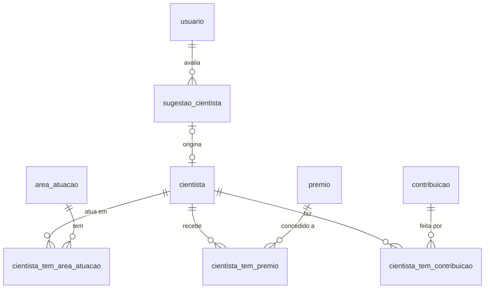

# Banco de dados

O banco segue o **Modelo Relacional entregue em Banco de Dados I em 02/10**. Os nomes das tabelas e das colunas são os
mesmos do modelo. Alguns tipos foram ajustados para caber os dados reais; cada ajuste está explicado
[mais abaixo](#o-que-mudou-em-relação-ao-modelo-entregue-e-por-quê).

Os scripts ficam em `src/main/resources/db/`:

- `schema.sql`: cria o banco `portal_mulheres` e as 9 tabelas. Pode rodar de novo sem apagar dados (`CREATE ... IF NOT EXISTS`).
- `dados.sql`: dados de exemplo (6 áreas, 11 cientistas, 16 contribuições e 5 prêmios), os mesmos mostrados no site.
  Pode rodar de novo sem duplicar registros (`INSERT IGNORE`).

Os dois scripts usam `utf8mb4` (`SET NAMES utf8mb4` no início), para os acentos serem gravados corretamente.

## Tabelas

| Tabela | O que guarda |
|---|---|
| `usuario` | Pessoas da equipe que entram na área administrativa e avaliam as sugestões |
| `sugestao_cientista` | Sugestões de cientistas enviadas pelos visitantes do site |
| `cientista` | Dados de cada cientista exibida no portal |
| `area_atuacao` | Áreas de atuação (Física, Biologia, Computação...) |
| `cientista_tem_area_atuacao` | Em quais áreas cada cientista atua |
| `premio` | Prêmios que podem ser ligados às cientistas |
| `cientista_tem_premio` | Prêmios recebidos por cada cientista e a data (`recebido_em`) |
| `contribuicao` | Contribuições científicas |
| `cientista_tem_contribuicao` | Quais cientistas fizeram cada contribuição |

### Colunas

**`usuario`**: `id_usuario` (PK), `nome`, `email` (único), `senha_hash`, `data_criacao`

**`sugestao_cientista`**: `id_sugestao_cientista` (PK), `nome_cientista`, `justificativa`, `nome_sugestor`, `email_sugestor`,
`data_sugestao`, `status`, `id_usuario_revisor` (FK para `usuario`, opcional)

**`cientista`**: `id_cientista` (PK), `nome`, `biografia`, `instituicao_principal`, `data_nascimento`, `data_falescimento`,
`nacionalidade`, `id_sugestao_cientista` (FK para `sugestao_cientista`, opcional e única)

**`area_atuacao`**: `id_area_atuacao` (PK), `nome` (único), `descricao`

**`cientista_tem_area_atuacao`**: `cientista_id_cientista` (PK, FK), `area_atuacao_id_area_atuacao` (PK, FK)

**`premio`**: `id_premio` (PK), `nome`, `instituicao`

**`cientista_tem_premio`**: `cientista_id_cientista` (PK, FK), `premio_id_premio` (PK, FK), `recebido_em`

**`contribuicao`**: `id_contribuicao` (PK), `titulo`, `descricao`, `ano`, `link_referencia`

**`cientista_tem_contribuicao`**: `cientista_id_cientista` (PK, FK), `contribuicao_id_contribuicao` (PK, FK)

## Relações

| Relação | Tipo | Como fica no banco |
|---|---|---|
| Usuário avalia sugestão | 1:N | `sugestao_cientista.id_usuario_revisor` (vazio enquanto ninguém avaliou) |
| Sugestão dá origem a cientista | 1:1, opcional | `cientista.id_sugestao_cientista`, com chave única: uma sugestão vira no máximo um cadastro |
| Cientista atua em área | N:N | Tabela `cientista_tem_area_atuacao` |
| Cientista recebe prêmio | N:N, com a data | Tabela `cientista_tem_premio`, com `recebido_em` |
| Cientista tem contribuição | N:N | Tabela `cientista_tem_contribuicao`: uma contribuição pode ter mais de uma cientista |



Na API, as datas de prêmio aparecem só com o ano. Como o formulário pede apenas o ano, `recebido_em` é gravado como
1º de janeiro desse ano.

## O que mudou em relação ao modelo entregue e por quê

O modelo usava `VARCHAR(45)` em quase todas as colunas de texto. Esse tamanho não cabe vários dados reais do portal
nem os limites que o formulário do site aceita. Os tipos abaixo foram ajustados no `schema.sql`; os nomes continuam iguais.

| Tabela | Coluna | No modelo | No `schema.sql` | Motivo |
|---|---|---|---|---|
| `usuario` | `email` | `VARCHAR(45)` | `VARCHAR(150)` | E-mails podem passar de 45 caracteres. Mesmo limite do e-mail da sugestão. |
| `usuario` | `senha_hash` | `VARCHAR(45)` | `VARCHAR(255)` | O BCrypt gera 60 caracteres. 255 deixa folga caso o formato mude. |
| `usuario` | `data_criacao` | `VARCHAR` | `DATETIME` (padrão: data e hora atuais) | Guardar data como texto impede ordenar e comparar datas. |
| `sugestao_cientista` | `nome_cientista` | `VARCHAR(45)` | `VARCHAR(150)` | Mesmo limite do nome no formulário e na tabela `cientista`. |
| `sugestao_cientista` | `justificativa` | `VARCHAR(45)` | `TEXT` | O formulário aceita de 20 a 2000 caracteres. |
| `sugestao_cientista` | `nome_sugestor` | `VARCHAR(45)` | `VARCHAR(100)` | Mesma regra do formulário (até 100 caracteres). |
| `sugestao_cientista` | `email_sugestor` | `VARCHAR(45)` | `VARCHAR(150)` | Mesma regra do formulário (até 150 caracteres). |
| `sugestao_cientista` | `status` | sem regra | `CHECK` com `PENDENTE`, `APROVADA` ou `RECUSADA` (padrão `PENDENTE`) | Impede gravar um status que o sistema não conhece. |
| `cientista` | `nome` | `VARCHAR(45)` | `VARCHAR(150)` | Nomes completos podem ser longos. Mesmo limite do formulário. |
| `cientista` | `instituicao_principal` | `VARCHAR(45)` | `VARCHAR(150)` | Nomes de instituições costumam ser longos. Mesmo limite do formulário. |
| `premio` | `nome` | `VARCHAR(45)` | `VARCHAR(150)` | "Prêmio L'Oréal-UNESCO para Mulheres na Ciência" tem 46 caracteres. |
| `contribuicao` | `titulo` | `VARCHAR(45)` | `VARCHAR(200)` | Há títulos com mais de 45 caracteres, como "Bactérias fixadoras de nitrogênio em gramíneas" (46). |
| `contribuicao` | `descricao` | `VARCHAR(45)` | `TEXT` | As descrições são frases inteiras: nos dados de exemplo, têm de 65 a 111 caracteres. O formulário aceita até 2000. |
| `contribuicao` | `link_referencia` | `VARCHAR(45)` | `VARCHAR(500)` | Endereços de referência são longos. O primeiro link dos dados de exemplo já tem 72 caracteres. |

Colunas que continuam como no modelo, com `VARCHAR(45)`: `usuario.nome`, `sugestao_cientista.status`,
`cientista.nacionalidade`, `area_atuacao.nome`, `area_atuacao.descricao` e `premio.instituicao`. Por isso a API limita
a nacionalidade e o concedente do prêmio a 45 caracteres.

O script também tem estas regras de integridade:

- `usuario.email` é único (`uk_usuario_email`): duas contas não podem ter o mesmo e-mail.
- `area_atuacao.nome` é único (`uk_area_nome`).
- `cientista.id_sugestao_cientista` é único (`uk_cientista_sugestao`).
- As chaves estrangeiras das tabelas de ligação (`cientista_tem_area_atuacao`, `cientista_tem_premio` e
  `cientista_tem_contribuicao`) usam `ON DELETE CASCADE ON UPDATE CASCADE`: ao apagar uma cientista, área, prêmio ou
  contribuição, os vínculos dela são apagados juntos.
- As ligações opcionais (`sugestao_cientista.id_usuario_revisor` e `cientista.id_sugestao_cientista`) usam
  `ON DELETE SET NULL ON UPDATE CASCADE`: apagar o usuário ou a sugestão não apaga a sugestão nem a cientista,
  só deixa a ligação vazia.

### Ponto a corrigir numa próxima versão do modelo

A coluna `cientista.data_falescimento` mantém a grafia do modelo entregue, para o banco ficar igual ao documento.
A grafia correta é `data_falecimento`. Na API e no site o campo já se chama `dataFalecimento`. Quando o modelo for
corrigido, basta renomear a coluna no `schema.sql`, no `dados.sql` e na entidade `Cientista`.

## Como criar o banco local

Precisa do MySQL 8.4 rodando. Os comandos abaixo são executados na pasta do `api-portal`.

**Linux, macOS ou Git Bash:**

```bash
mysql -u root -p < src/main/resources/db/schema.sql
mysql -u root -p < src/main/resources/db/dados.sql
```

**Windows (PowerShell):** no PowerShell o operador `<` não funciona. Use o `cmd` para fazer o redirecionamento:

```powershell
cmd /c "mysql -u root -p < src\main\resources\db\schema.sql"
cmd /c "mysql -u root -p < src\main\resources\db\dados.sql"
```

Ou leia o arquivo com `Get-Content` e envie para o `mysql`. No Windows PowerShell, defina antes a codificação UTF-8;
sem isso, os acentos chegam errados ao banco:

```powershell
$OutputEncoding = New-Object System.Text.UTF8Encoding $false
Get-Content src/main/resources/db/schema.sql -Raw -Encoding UTF8 | mysql -u root -p
Get-Content src/main/resources/db/dados.sql -Raw -Encoding UTF8 | mysql -u root -p
```

Rode sempre o `schema.sql` antes do `dados.sql`.

### Se você já tinha o banco de uma versão anterior

O `schema.sql` não altera tabelas que já existem. Se o banco `portal_mulheres` foi criado com a estrutura antiga
(por exemplo, com as tabelas `cientista_area_atuacao` e `cientista_premio`), apague o banco e rode os dois scripts de novo:

```bash
mysql -u root -p -e "DROP DATABASE IF EXISTS portal_mulheres;"
```

Esse comando apaga **todos** os dados do banco local. No Docker, o equivalente é `docker compose down -v`.

### Conferir

```bash
mysql -u root -p --default-character-set=utf8mb4 -e "SELECT id_cientista, nome FROM portal_mulheres.cientista;"
```

Devem aparecer as 11 cientistas, com os acentos corretos.

## Como a aplicação se conecta

A conexão vem de variáveis de ambiente (veja `src/main/resources/application.properties`):

| Variável | Padrão |
|---|---|
| `DB_URL` | `jdbc:mysql://localhost:3306/portal_mulheres` |
| `DB_USER` | `root` |
| `DB_PASSWORD` | vazio |

Exemplo no Linux, macOS ou Git Bash:

```bash
DB_PASSWORD=sua_senha ./mvnw spring-boot:run
```

No Windows (PowerShell):

```powershell
$env:DB_PASSWORD="sua_senha"; .\mvnw.cmd spring-boot:run
```

**Nunca** coloque a senha real no `application.properties`.

A aplicação não cria nem altera tabelas (`spring.jpa.hibernate.ddl-auto=validate`): ela só confere, ao subir, se as
entidades batem com as tabelas. Se o banco estiver com a estrutura antiga, a API não sobe e o log mostra qual tabela ou
coluna está faltando.

Para entrar na área da equipe, defina também `ADMIN_EMAIL` e `ADMIN_SENHA` (veja o `README.md`).

## Testes

Os testes usam um banco H2 em memória (`src/test/resources/application.properties`), então
`./mvnw test` (no PowerShell, `.\mvnw.cmd test`) funciona sem MySQL instalado. Nos testes, as tabelas são criadas a partir
das entidades.
